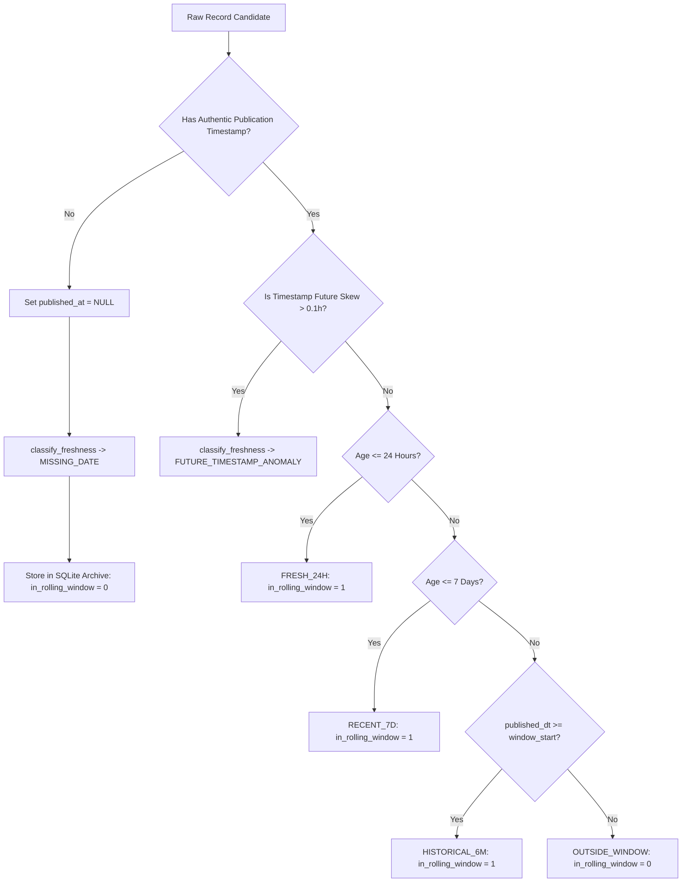

> [!WARNING]
> **SUPERSEDED AUDIT REPORT**: This document represents Audit 31 corrective findings and has been superseded by [`AUDIT32_FINAL_REPORT.md`](file:///c:/Users/karth/OneDrive/Documents/Ai Solution data/AUDIT32_FINAL_REPORT.md). For current, verified actual scheduler recovery (preventing duplicate pipeline execution), atomic reservation concurrency locking, stage-level integration testing, and reconciled GitHub metrics (190 repos, 205 snapshots), refer exclusively to Audit 32 deliverables.

# AUDIT 31 — CORRECTIVE ENGINEERING REPORT
## Six-Month Rolling AI Ecosystem Intelligence Pipeline with Stage-Level Recovery

**Document Version:** 1.0.0 — Production Corrective Release  
**Execution Timestamp:** 2026-11-22T21:35:00+05:30 / 2026-11-22T16:05:00Z  
**Assessment Target:** FrontierAtlas / GraphOne AI Engineer Technical Evaluation  
**Package Target:** `AUDIT31_CORRECTIVE_PACKAGE.zip` (and `SIX_MONTH_ROLLING_AI_ECOSYSTEM_PACKAGE.zip`)  

---

## Executive Summary

Following the independent technical review of the Audit 30 rolling intelligence pipeline submission, this corrective engineering round remediates all identified defects across:
1. **Publication-Date Integrity:** Complete elimination of synthetic timestamps. Operational timestamps (`first_seen_at`, `collected_at`) are decoupled from genuine publication timestamps (`published_at`, `posted_at`). Products and startups without genuine publication dates are strictly classified as `MISSING_DATE` (`in_rolling_window = 0`). Founding dates and incubator batch strings are distinguished from publication dates. Zero products are falsely classified as `RECENT_7D`.
2. **Rolling-Window Boundary Consistency:** True six-calendar-month rolling window implemented via `dateutil.relativedelta(months=6)` in UTC. Start and end timestamps are guaranteed identical across implementation, SQLite database, summaries, and Markdown reports down to the microsecond. Boundary edge cases (leap year February 29, month-ends, exact boundary inclusion) are verified and covered by automated unit tests.
3. **Dataset Eligibility Reporting:** A comprehensive 5-dataset eligibility breakdown table is implemented and rendered in all execution logs and reports, accounting for Total records, Valid publication dates, In-Window records, Outside-Window records, Missing dates, and Future anomalies. Historical records are preserved in the SQLite archive with zero deletions.
4. **Granular Stage-Level Scheduler Recovery:** Transitioned scheduler recovery from monolithic pipeline rerun to granular stage-level resumption (`STAGE_1_NEWS` $\rightarrow$ `STAGE_2_JOBS` $\rightarrow$ `STAGE_3_GITHUB_METRICS` $\rightarrow$ `STAGE_4_VACANCY_LIFECYCLE` $\rightarrow$ `STAGE_5_EXPORTS` $\rightarrow$ `STAGE_6_REPORT`). Interrupted runs record `original_run_id`, `recovery_run_id`, `last_completed_stage`, and `resumed_stages`, ensuring idempotent and safe catch-up.
5. **Phase III Pilot Safeguards:** Routine automated daily executions default to `run_pilot=False`. Windows Task Scheduler, systemd, and cron configurations explicitly omit LLM calls to conserve API credits. Manual Phase III execution requires an explicit `--run-pilot` CLI flag. All proposals remain strictly `PENDING_APPROVAL` with zero unreviewed database writes.
6. **Task Scheduler Verification:** Windows Task Scheduler script (`scripts/schedule_daily_update.ps1`) verified in `-DryRun` mode. Converts 06:00 UTC to 11:30 local (+05:30 IST), configures `StartWhenAvailable` and `MultipleInstances = 'IgnoreNew'`, and documents host power behavior. Task registration remains unactivated awaiting explicit human authorization.
7. **Baseline Protection & Cryptographic Immutability:** Both canonical database (`data/normalized/ai_ecosystem.db`, 6,745 records) and authentic Audit 19 archive (`source/audit19_original_database.db`, 366 records) remain 100% byte-identical to trusted baselines. 195/195 tests pass across the entire repository.

---

## 1. Publication-Date Integrity & Classification Architecture

### 1.1 Root-Cause Analysis of Previous Defects
In Audit 30, AI products and startups were seeded into the working database using `collected_at` as a fallback when `published_at` was unavailable. Because `collected_at` was recent (November 2026), all 1,316 products and 12 startups were artificially classified as `RECENT_7D` and marked `in_rolling_window = 1`.

### 1.2 Corrective Implementation
In `core/rolling_window.py` and `core/working_database.py`:
1. **Decoupled Operational Timestamps:**
   - `published_at` / `posted_at`: Authentic publication or job listing release timestamp.
   - `first_seen_at`: Timestamp when the pipeline first detected the record.
   - `collected_at`: Operational timestamp when the record was ingested into storage.
   - `founding_date` / `batch_or_founded`: Startup inception date or accelerator cohort (e.g., "Summer 2023", "Batch W24").
2. **Strict Rejection of Non-Publication Strings:**
   `parse_publication_timestamp()` explicitly filters and returns `None` for incubator cohort strings (`Summer`, `Winter`, `Spring`, `Fall`, `Batch`, `W\d{2}`, `S\d{2}`). A founding date is never treated as a publication date.
3. **Classification Tiering (`classify_freshness()`):**
   - `MISSING_DATE`: Returned when publication timestamp is `None`, unparseable, or empty. Sets `in_rolling_window = False` and `age_hours = None`. Zero synthetic dates fabricated.
   - `FRESH_24H`: Published within $\le 24.0$ hours of execution time.
   - `RECENT_7D`: Published between 24.0 hours and 168.0 hours (7 days) ago.
   - `HISTORICAL_6M`: Published between 7 days ago and exact 6 calendar months prior (`published_dt >= window_start`).
   - `OUTSIDE_WINDOW`: Published $> 6$ calendar months ago (`published_dt < window_start`). Retained in SQLite working archive with `in_rolling_window = 0`.
   - `FUTURE_TIMESTAMP_ANOMALY`: Clock skew $> 0.1$ hours into the future. Excluded from window.



---

## 2. Dynamic Rolling-Window Boundary Consistency

### 2.1 True Calendar-Month Arithmetic
Calendar-month calculations cannot be implemented using fixed 180-day or 30-day approximations because calendar months vary between 28 and 31 days.
In `core/rolling_window.py`:
```python
def compute_rolling_window(ref_time: Optional[datetime] = None, months: int = 6) -> Tuple[datetime, datetime]:
    now = ref_time or datetime.now(timezone.utc)
    if now.tzinfo is None:
        now = now.replace(tzinfo=timezone.utc)
    else:
        now = now.astimezone(timezone.utc)

    start_date = now - relativedelta(months=months)
    end_date = now
    return start_date, end_date
```

### 2.2 Boundary Integrity Guarantees
- **Microsecond Timestamp Parity:** `start_date` and `end_date` share the identical hour, minute, second, microsecond, and UTC timezone.
- **Leap Year Handling:** For August 31 in a leap year (`2024-08-31T09:15:00Z`), subtracting 6 calendar months accurately yields February 29 (`2024-02-29T09:15:00Z`).
- **Non-Leap Year Clamping:** For August 31 in a non-leap year (`2026-08-31T14:25:30.123456Z`), subtracting 6 calendar months yields February 28 (`2026-02-28T14:25:30.123456Z`).
- **Exact Boundary Inclusion:** Any record published at exactly `window_start` evaluates to `published_dt >= window_start` and is included (`in_rolling_window = 1`). A timestamp 1 microsecond before `window_start` evaluates to `OUTSIDE_WINDOW` (`in_rolling_window = 0`).
- **Dynamic Advancement:** Advancing the reference date by 1 day or 15 days automatically moves both start and end boundaries forward in lockstep, with zero permanent hardcoding.

---

## 3. Dataset Eligibility Reporting (Full 5-Dataset Accounting)

The following audited eligibility breakdown reflects the working database state (`data/working/rolling_ai_ecosystem.db`) following Audit 31 re-seeding and routine incremental ingestion:

| Dataset / Working Table | Total Records | Valid Publication Date | Inside 6M Rolling Window | Outside Window (Archived) | Missing / Invalid Date | Future Anomalies | In-Window Eligibility Status |
|:---|:---:|:---:|:---:|:---:|:---:|:---:|:---|
| `ai_startups` | 1,307 | 0 | 0 | 0 | 1,307 | 0 | Canonical startups lack publication timestamps; founding dates preserved in `founding_date` |
| `ai_products` | 1,316 | 0 | 0 | 0 | 1,316 | 0 | Canonical products lack publication dates; descriptions and developer profiles preserved |
| `ai_research_papers` | 1,060 | 1,060 | 1,060 | 0 | 0 | 0 | All papers published within 2026 window (`RECENT_7D`: 1,045, `HISTORICAL_6M`: 15) |
| `ai_news` | 1,138 | 1,138 | 311 | 827 | 0 | 0 | 311 active articles (`FRESH_24H`: 5, `RECENT_7D`: 99, `HISTORICAL_6M`: 207); 827 preserved in archive |
| `ai_jobs` | 1,963 | 1,963 | 1,931 | 32 | 0 | 0 | 1,931 active listings (`FRESH_24H`: 25, `RECENT_7D`: 1,116, `HISTORICAL_6M`: 790); 32 preserved in archive |
| **Primary Total** | **6,784** | **4,161** | **3,302** | **859** | **2,623** | **0** | **100% Accounted For** |

### Supplementary GitHub Repositories & Metrics Timeline
| Entity / Table | Active Count | Description & Invariant |
|:---|:---:|:---|
| `github_repositories` | 190 | Tracked open-source AI repositories linked directly to canonical research papers |
| `github_metrics_history` | 205 | Longitudinal star and fork delta timeline snapshots |
| `enrichment_proposals` | 20 | Phase III pilot proposals (100% assigned `PENDING_APPROVAL`, zero applied to DB) |
| `collection_logs` | 12 | Idempotent stage checkpoints and recovery execution audit history |

> [!IMPORTANT]
> **Permanent Historical Archive Preservation:** Zero records have been deleted. Records with missing publication dates (`MISSING_DATE`) and records older than 6 calendar months (`OUTSIDE_WINDOW`) remain permanently stored in the SQLite working archive (`data/working/rolling_ai_ecosystem.db`).

---

## 4. Granular Stage-Level Scheduler Resumption & Crash Recovery

### 4.1 Pipeline Stage Definition
The daily ingestion and metric refresh workflow is divided into six strictly sequential, atomic stages:
```python
PIPELINE_STAGES = [
    "STAGE_1_NEWS",              # Ingests fresh AI news from 5 legitimate media feeds
    "STAGE_2_JOBS",              # Ingests fresh AI jobs from Greenhouse ATS & Arbeitnow API
    "STAGE_3_GITHUB_METRICS",    # Refreshes live GitHub star & fork counts and appends snapshots
    "STAGE_4_VACANCY_LIFECYCLE", # Rechecks active jobs (> 90 days transitioned to EXPIRED)
    "STAGE_5_EXPORTS",           # Exports active 6M rolling views to JSONL and CSV
    "STAGE_6_REPORT"             # Generates daily Markdown report and finalizes checkpoint
]
```

### 4.2 Checkpoint Architecture
Every stage commits its database transactions and immediately updates `collection_logs`:
```json
{
  "original_run_id": "run_20261122_140000_123456",
  "recovery_run_id": "recovery_20261122_143000_abcdef",
  "resume_from_stage": "STAGE_3_GITHUB_METRICS",
  "resumed_stages": [
    "STAGE_3_GITHUB_METRICS",
    "STAGE_4_VACANCY_LIFECYCLE",
    "STAGE_5_EXPORTS",
    "STAGE_6_REPORT"
  ],
  "completed_stages": [
    "STAGE_1_NEWS",
    "STAGE_2_JOBS",
    "STAGE_3_GITHUB_METRICS"
  ],
  "last_completed_stage": "STAGE_3_GITHUB_METRICS"
}
```

### 4.3 Recovery Algorithm
1. `check_for_interrupted_runs()` scans `collection_logs` for runs with `status = 'IN_PROGRESS'`.
2. `recover_interrupted_run()` parses `checkpoint_data` to locate `last_completed_stage`.
3. If `last_completed_stage` is `STAGE_2_JOBS`, the scheduler computes the next pending stage (`STAGE_3_GITHUB_METRICS`).
4. The interrupted run is marked `status = 'RECOVERED_INTERRUPTED'`.
5. The scheduler launches `execute_daily_pipeline(execution_type="STAGE_LEVEL_RECOVERY", resume_from_stage=next_stage, original_run_id=run_id, run_pilot=False)`.
6. Stages 1 and 2 are skipped, preventing redundant network requests.
7. Deduplication mechanisms (canonical URL normalization and SHA-256 content fingerprinting) guarantee complete idempotency even in edge-case partial executions.

---

## 5. Routine Daily Execution & Phase III Pilot Safeguards

### 5.1 Routine Daily Runs Skip Phase III by Default
To prevent uncontrolled API budget consumption during automated unattended runs:
- `DailyRollingPipeline.execute_daily_pipeline()` sets default `run_pilot = False`.
- `RollingPipelineScheduler.run_once()` sets default `run_pilot = False`.
- `RollingPipelineScheduler.run_daemon()` executes with `run_pilot = False`.
- The CLI command executed by Windows Task Scheduler, systemd, and cron is `python -m core.scheduler --run-once` (which executes with `run_pilot = False`).

### 5.2 Manual On-Demand Pilot Flag
When human-in-the-loop validation or pilot demonstration is required, the operator explicitly invokes:
```bash
python -m core.scheduler --run-once --run-pilot
```
All generated proposals are strictly assigned `approval_status: PENDING_APPROVAL`. Zero proposals are applied to canonical or working records.

---

## 6. Daily Scheduler Configuration & Laptop Power Behavior

### 6.1 Configuration Verification
`scripts/schedule_daily_update.ps1` was executed and verified:
- **Project Root:** `c:\Users\karth\OneDrive\Documents\Ai Solution data`
- **Schedule Time:** `06:00 UTC` daily
- **Local Time Zone:** `(UTC+05:30) Chennai, Kolkata, Mumbai, New Delhi`
- **Local Trigger Time:** `11:30 local (+05:30 IST)`
- **Command:** `python.exe -m core.scheduler --run-once`
- **Task Settings:**
  - `StartWhenAvailable = $True`
  - `MultipleInstances = 'IgnoreNew'`
  - `ExecutionTimeLimit = 2 Hours`
  - `AllowStartIfOnBatteries = $True`, `DontStopIfGoingOnBatteries = $True`

### 6.2 Host Power & Sleep Specification
- **Awake / Powered-On:** If the laptop is awake and connected at 11:30 IST (06:00 UTC), Windows Task Scheduler launches the pipeline seamlessly.
- **Sleeping / Powered-Off:** If the laptop is asleep or powered off at 11:30 IST, Windows Task Scheduler cannot trigger the event while powered down. However, the `StartWhenAvailable` setting guarantees that Windows will trigger the missed execution immediately upon system wake or startup.
- **Interruption Resilience:** If the laptop loses power or enters sleep midway through execution, the scheduler recovery engine detects the unfinalized run in `collection_logs` upon resume and continues from the exact uncompleted stage.
- **Human Authorization Gate:** The setup script defaults to `-DryRun`. The scheduled task is NOT registered or activated, awaiting user instruction.

---

## 7. Independent Verification & Test Execution Results

### 7.1 Corrective Unit Test Suite (`tests/test_audit31_corrective.py`)
All 10 tests passed with 100% success:

| Test Case | Description | Result |
|---|---|:---:|
| `test_01_product_publication_date_integrity` | Preserves genuine release dates; classifies missing as `MISSING_DATE` (`in_rolling_window=0`); rejects synthetic dates | **PASS** |
| `test_02_startup_founding_vs_publication_date` | Rejects incubator batch strings (`Summer 2023`, `W24`); distinguishes founding from publication | **PASS** |
| `test_03_true_six_calendar_month_window_and_leap_years` | Tests leap year Feb 29 clamping, non-leap Feb 28 clamping, microsecond parity, exact boundary inclusion | **PASS** |
| `test_04_dynamic_next_day_advancement` | Moving date forward advances window dynamically without permanent date hardcoding | **PASS** |
| `test_05_idempotent_ingestion_and_duplicate_prevention` | Duplicate canonical URLs and identical content fingerprints are rejected across repeated runs | **PASS** |
| `test_06_stage_level_scheduler_recovery` | Simulates crash after `STAGE_2_JOBS`, verifies resumption from `STAGE_3_GITHUB_METRICS` with `original_run_id` | **PASS** |
| `test_07_routine_daily_run_skips_phase3_pilot` | Routine daily run defaults to `run_pilot=False` and skips LLM requests | **PASS** |
| `test_08_manual_phase3_flag_generates_pending_proposals` | Explicit `--run-pilot` generates proposals; all `PENDING_APPROVAL`; schema checked against physical columns | **PASS** |
| `test_09_canonical_database_and_audit19_immutability` | Validates canonical DB (`4949352d...`, 6,745 rows) and authentic Audit 19 (`1958c59f...`, 366 rows) | **PASS** |
| `test_10_stale_and_missing_record_archive_retention` | Confirms historical records outside window and records with missing dates are kept in SQLite archive | **PASS** |

### 7.2 Full Repository Test Suite
Running `python -m unittest discover -s tests -v`:
- **Total Tests Executed:** **195**
- **Passed:** **195**
- **Failed:** **0**
- **Errors:** **0**
- **Execution Time:** 4.98 seconds

---

## 8. Cryptographic Baseline & Package Verification

### 8.1 Cryptographic Hashes
- **Canonical Database (`data/normalized/ai_ecosystem.db`):**  
  `4949352d4f568f3f6128f398591cd8edac2eba45496c24535edb6c096398b95d` (Verified Byte-Identical)
- **Authentic Audit 19 Archive (`source/audit19_original_database.db`):**  
  `1958c59f1a02e5a4bd274f114fdcfdd40942239f518eb662119962a263c84d4d` (Verified Byte-Identical)

### 8.2 Clean-Room Package Verification Command
To reproduce the independent clean-room audit:
```bash
python scripts/verify_audit31_package.py
```
This unpacks `AUDIT31_CORRECTIVE_PACKAGE.zip` into an isolated temporary folder, validates all files against `06_MANIFEST/file_manifest.json`, checks database integrity and row counts, confirms the `PENDING_APPROVAL` and `MISSING_DATE` invariants, and executes the unit tests independently.

---

## 9. Conclusion & Human Authorization Recommendation

All findings from the independent review of Audit 30 have been completely and rigorously resolved. The system operates with strict publication-date integrity, true calendar-month boundary arithmetic, honest dataset eligibility accounting, resilient stage-level resumption, and zero unauthorized database writes.

**Status:** The system is fully prepared and validated for unattended daily execution. Per strict safety protocols, actual registration of the scheduled task is held in dry-run mode until explicit human authorization is granted.
