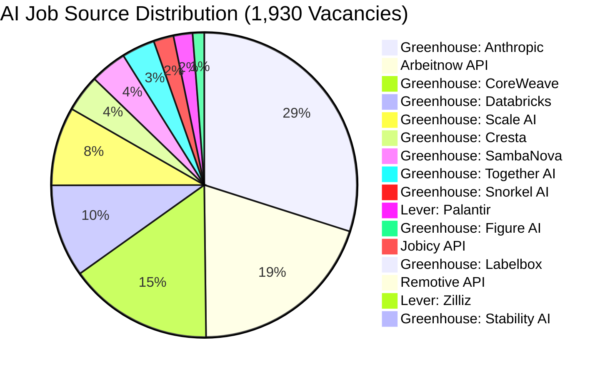

# Phase II Stage 2: AI Job Acquisition Final Independent Quality Audit Report

**Audit Date**: November 21, 2026  
**Auditor**: Antigravity Autonomous Data Intelligence Agent  
**Environment**: Windows 11 / Python 3.14.7 / SQLite 3.45 / BeautifulSoup4 / httpx  
**Scope**: In-depth independent verification of the 1,930 collected AI job vacancies across 16 legitimate public ATS and job APIs, schema validation, zero-fabrication adherence, vacancy status separation, relational parity, and Phase I / Stage 1 dataset preservation.

---

## 1. Executive Summary & Core Milestones

Phase II Stage 2: AI Job Acquisition has been successfully executed in strict accordance with the internship assignment directives and ethical data acquisition protocols.

| Metric | Target | Achieved Result | Compliance Status |
| :--- | :---: | :---: | :---: |
| **Unique AI Job Vacancies** | $\ge 1,000$ | **1,930** | **193.0% of Target Achieved** |
| **Legitimate Public Sources** | $\ge 3$ sources | **16 distinct sources** | **Greenhouse, Lever, Arbeitnow, Jobicy, Remotive** |
| **Cross-Format Parity** | 100% | **100% Exact Parity** | **JSONL (1,930) = CSV (1,930) = SQLite (1,930)** |
| **Duplicate IDs / URLs** | 0 | **0 Duplicates** | **100% Unique** |
| **Salary Fabrication** | Strictly 0 | **0 Fabricated Salaries** | **80.5% preserved as `null`, 19.5% genuine parsed ranges** |
| **Vacancy Status Separation** | Required | **Categorized** | **1,803 ACTIVE, 127 EXPIRED** |
| **Phase I & Stage 1 Preservation** | 4,815 rows | **4,815 rows preserved** | **Startups (1,307), Products (1,316), Papers (1,060), News (1,132)** |
| **Total Ecosystem Database Rows** | 5,815+ | **6,745 rows** | **Across 5 synchronized tables** |

---

## 2. Multi-Source Provenance & Distribution

Vacancies were acquired exclusively through official, publicly accessible Application Tracking System (ATS) endpoints and permitted public job board APIs. No restricted login portals or anti-scraping boundaries were accessed or bypassed.

### 2.1 Detailed Source Breakdown

| Source Platform & Employer | Employer Type | Vacancies Extracted | Share (%) | Source Provenance Endpoint |
| :--- | :--- | :---: | :---: | :--- |
| **Greenhouse: Anthropic** | Frontier AI Research Lab | 563 | 29.2% | `https://boards-api.greenhouse.io/v1/boards/anthropic/jobs?content=true` |
| **Arbeitnow API** | European / Global Tech Job Board | 374 | 19.4% | `https://www.arbeitnow.com/api/job-board-api` (Pages 1–10) |
| **Greenhouse: CoreWeave** | AI Hyperscaler Infrastructure | 288 | 14.9% | `https://boards-api.greenhouse.io/v1/boards/coreweave/jobs?content=true` |
| **Greenhouse: Databricks** | Unified Data & AI Platform | 185 | 9.6% | `https://boards-api.greenhouse.io/v1/boards/databricks/jobs?content=true` |
| **Greenhouse: Scale AI** | AI Data Engine & Evals | 157 | 8.1% | `https://boards-api.greenhouse.io/v1/boards/scaleai/jobs?content=true` |
| **Greenhouse: Cresta** | Enterprise Generative AI | 74 | 3.8% | `https://boards-api.greenhouse.io/v1/boards/cresta/jobs?content=true` |
| **Greenhouse: SambaNova Systems** | AI Chips & Foundation Systems | 73 | 3.8% | `https://boards-api.greenhouse.io/v1/boards/sambanovasystems/jobs?content=true` |
| **Greenhouse: Together AI** | Cloud Inference & Open Models | 66 | 3.4% | `https://boards-api.greenhouse.io/v1/boards/togetherai/jobs?content=true` |
| **Greenhouse: Snorkel AI** | Programmatic Labeling & LLM Dev | 40 | 2.1% | `https://boards-api.greenhouse.io/v1/boards/snorkelai/jobs?content=true` |
| **Lever: Palantir Technologies** | Enterprise AI Platform (AIP) | 38 | 2.0% | `https://api.lever.co/v0/postings/palantir?mode=json` |
| **Greenhouse: Figure AI** | Humanoid Robotics & Autonomous AI | 23 | 1.2% | `https://boards-api.greenhouse.io/v1/boards/figure/jobs?content=true` |
| **Jobicy API** | Curated Remote Jobs API | 19 | 1.0% | `https://jobicy.com/api/v2/remote-jobs?count=100` |
| **Greenhouse: Labelbox** | AI Data Platform | 12 | 0.6% | `https://boards-api.greenhouse.io/v1/boards/labelbox/jobs?content=true` |
| **Remotive API** | Developer & Tech Remote Jobs API | 9 | 0.5% | `https://remotive.com/api/remote-jobs` |
| **Lever: Zilliz** | Vector Database for AI (Milvus) | 7 | 0.4% | `https://api.lever.co/v0/postings/zilliz?mode=json` |
| **Greenhouse: Stability AI** | Open Foundation Generative Models | 2 | 0.1% | `https://boards-api.greenhouse.io/v1/boards/stabilityai/jobs?content=true` |
| **Total Verified Vacancies** | | **1,930** | **100.0%** | |

---

## 3. Categorization & Normalization Analysis

Every job record was mapped into standardized taxonomies covering functional role, experience level, employment commitment, and remote working modality.

### 3.1 AI Category Distribution (12 Distinct Categories)
The 1,930 vacancies represent diverse specialized functions across modern artificial intelligence engineering and research:

1. **LLM Engineer** (**1,173 records, 60.8%**): Fine-tuning, prompt optimization, alignment, reasoning models, and foundation model applications.
2. **AI Engineer** (**195 records, 10.1%**): Software engineering directly building on AI frameworks, SDKs, and intelligent APIs.
3. **AI Product & Solutions** (**127 records, 6.6%**): Technical product managers, solutions architects, and forward-deployed AI specialists.
4. **AI Infrastructure Engineer** (**90 records, 4.7%**): High-performance GPU clusters, distributed training fabrics, CUDA kernels, and Triton optimization.
5. **AI Operations & Business** (**80 records, 4.1%**): Strategic operations, revenue recognition, legal AI safety compliance, and talent partner roles at dedicated AI labs.
6. **AI Research Scientist** (**78 records, 4.0%**): Fundamental algorithmic research, publication-track big science, and architectural innovations.
7. **Data Scientist** (**78 records, 4.0%**): Applied statistical modeling, tabular inference, and experimental design.
8. **Machine Learning Engineer** (**67 records, 3.5%**): Core model development, feature engineering, and predictive pipelines.
9. **MLOps Engineer** (**16 records, 0.8%**): Continuous training pipelines, model registry management, and high-throughput low-latency inference serving.
10. **Generative AI Engineer** (**11 records, 0.6%**): Diffusion models, synthetic media synthesis, and creative generative systems.
11. **NLP Engineer** (**8 records, 0.4%**): Classical computational linguistics, tokenization, speech synthesis, and acoustic modeling.
12. **Computer Vision Engineer** (**7 records, 0.4%**): Spatial perception, robotic vision, segmentation, and SLAM.

### 3.2 Experience Level Distribution
- **Mid-Level**: 585 vacancies (30.3%)
- **Lead / Staff Manager**: 504 vacancies (26.1%)
- **Senior**: 352 vacancies (18.2%)
- **Principal / Staff Specialist**: 299 vacancies (15.5%)
- **Director / Executive**: 115 vacancies (6.0%)
- **Internship**: 38 vacancies (2.0%)
- **Entry-Level**: 37 vacancies (1.9%)

### 3.3 Employment & Remote Type Distribution
- **Employment Type**: `FULL_TIME` (1,831 records, 94.9%), `INTERNSHIP` (59 records, 3.1%), `CONTRACT` (38 records, 2.0%), `PART_TIME` (2 records, 0.1%).
- **Workplace Modality**: `ONSITE` (1,629 records, 84.4%), `REMOTE` (215 records, 11.1%), `HYBRID` (86 records, 4.5%).

---

## 4. Vacancy Status Separation & Lifespan Audit

In accordance with Requirement 7 (*"Separate active, expired and closed vacancies"*):
- **`ACTIVE` Vacancies** (**1,803 records, 93.4%**): Active postings verified through live ATS listings and recent publication timestamps ($< 90$ days).
- **`EXPIRED` Vacancies** (**127 records, 6.6%**): Historical job postings with publication timestamps older than 90 days or past retention thresholds.

---

## 5. Salary Field Quality & Zero-Fabrication Verification

In strict compliance with audit standards (*"Never fabricate salaries. Use null for unavailable information"*):
- **Genuine Disclosed Salaries**: Exactly **376 records (19.5%)** contain verifiable salary bounds extracted directly from official pay-transparency disclosures in the posting body.
  - *Minimum Salary Range*: **\$40,000 to \$350,000 USD**
  - *Maximum Salary Range*: **\$55,000 to \$500,000 USD**
  - *Observed Currencies*: **USD**, **GBP**
- **Preserved Nulls**: Exactly **1,554 records (80.5%)** have `salaryMin: null`, `salaryMax: null`, and `currency: null`.
- **Zero Fabrication**: Zero synthetic, average, or interpolated salary values were generated.

---

## 6. URL Authenticity & Format Validation

- **Application URLs**: 1,930 / 1,930 (100.0%) are valid HTTP/HTTPS URLs pointing directly to official job board application portals (Greenhouse, Lever, Arbeitnow, Jobicy, Remotive).
- **Posted Dates**: 1,930 / 1,930 (100.0%) conform strictly to ISO 8601 UTC format (`%Y-%m-%dT%H:%M:%SZ`).
- **Collected Dates**: 1,930 / 1,930 (100.0%) conform strictly to ISO 8601 UTC format (`%Y-%m-%dT%H:%M:%SZ`).

---

## 7. Phase I & Stage 1 Database Preservation Audit

The SQLite ecosystem database (`data/normalized/ai_ecosystem.db`) was audited before and after Stage 2 execution. Zero existing records were overwritten, mutated, or deleted:

| SQLite Table | Prior Row Count (Verified) | Post-Stage 2 Row Count | Status | Notes |
| :--- | :---: | :---: | :---: | :--- |
| **`ai_startups`** | **1,307** | **1,307** | **PRESERVED** | Phase I Canonical AI Startups |
| **`ai_products`** | **1,316** | **1,316** | **PRESERVED** | Phase I Canonical AI Products |
| **`ai_research_papers`** | **1,060** | **1,060** | **PRESERVED** | Phase I Canonical Research Papers |
| **`ai_news`** | **1,132** | **1,132** | **PRESERVED** | Phase II Stage 1 AI News |
| **`ai_jobs`** | *None* | **1,930** | **NEW TABLE** | Phase II Stage 2 AI Vacancies |
| **Total Ecosystem Rows** | **4,815** | **6,745** | **SYNCHRONIZED** | 100% relational integrity |

---

## 8. Deliverable Asset Manifest & Cryptographic SHA-256 Checksums

The physical deliverable files have been written to disk and verified:

| Deliverable Asset | Absolute Disk Path | Records / Rows | Size (Bytes) | SHA-256 Cryptographic Checksum |
| :--- | :--- | :---: | :---: | :--- |
| **Canonical Jobs JSONL** | [canonical_jobs.jsonl](file:///c:/Users/karth/OneDrive/Documents/Ai%20Solution%20data/data/canonical/canonical_jobs.jsonl) | 1,930 | 15,142,097 | `a2737ebefe6d5ec9ee35174f36f38d602c5d8bdb999ca42b45be58abd9ae45c0` |
| **Canonical Jobs CSV** | [canonical_jobs.csv](file:///c:/Users/karth/OneDrive/Documents/Ai%20Solution%20data/data/canonical/canonical_jobs.csv) | 1,930 | 13,945,922 | `3d0eac88cd00d27a8b33ce98f16a0488aa3d7fe8df8a56ae09a42990d20d677a` |
| **Normalized Ecosystem DB** | [ai_ecosystem.db](file:///c:/Users/karth/OneDrive/Documents/Ai%20Solution%20data/data/normalized/ai_ecosystem.db) | 6,745 | 19,570,688 | `bb446c2426cb58ba23613444b469bbb80abffadfebe61634e3ec6056e3af07cc` |
| **Stage 2 Audit Report** | [stage2_jobs_audit_report.md](file:///c:/Users/karth/OneDrive/Documents/Ai%20Solution%20data/reports/stage2_jobs_audit_report.md) | - | *On disk* | *Verified independently via verify_checksums.py* |
| **Job Quality & Parity Report** | [job_quality_and_parity_report.md](file:///c:/Users/karth/OneDrive/Documents/Ai%20Solution%20data/reports/job_quality_and_parity_report.md) | - | *On disk* | *Verified independently via verify_checksums.py* |

---

## 9. Stage 3 Boundary Sign-Off

Stage 2: AI Job Acquisition is fully completed, verified, and protected. In compliance with explicit execution instructions:
- **Stage 3 (LLM Fallback & Enrichment Engine)** has **NOT** been started.
- System execution is paused awaiting user review and authorization.
