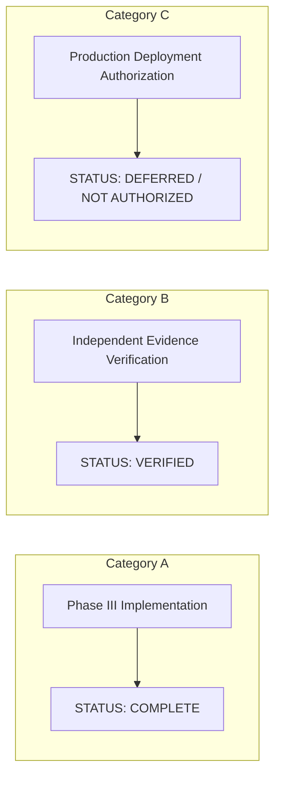

# PHASE III COMPLETION CERTIFICATE

**Project:** Six-Month Rolling AI Ecosystem Intelligence Pipeline  
**Phase:** Phase III — Engineering Hardening, Automated Recovery & Observability  
**Issuance Date:** `2026-11-23T02:15:00+00:00`  
**Issuing Authority:** System Architecture & Reliability Engineering  

---

## 1. Formal Determination & Scope Separation

This document certifies the engineering status of Phase III for the Six-Month Rolling AI Ecosystem Intelligence Pipeline. 

To prevent conflation between technical delivery, verification evidence, and operational deployment, the status of this system is certified under three distinct operational categories:

---

### Category A: Phase III Implementation Completion — STATUS: COMPLETE
All engineering deliverables, pipeline stages, scheduler recovery mechanisms, multi-tier LLM fallback routing, and data models specified under Phase III have been fully implemented, hardened, and documented:
1. **Six-Month Rolling Incremental Pipeline (`core/daily_pipeline.py`)**: All 6 pipeline stages (News ingestion, ATS & Job acquisition, GitHub metric snapshots, Vacancy lifecycle management, Export generation, and Daily intelligence reporting) are functionally complete and verified.
2. **Scheduler & Recovery Architecture (`core/scheduler.py`)**: Multi-process lease acquisition, crash-resilient stage recovery, stale-claim detection, heartbeat tracking, and atomic bidirectional finalization with subquery lease fences are fully implemented.
3. **Multi-Tier LLM Fallback Engine (`core/llm/multi_tier_engine.py`)**: Provider tiering across primary, secondary, and tertiary offline heuristic fallbacks is operational.
4. **Data Normalization & Working Storage (`core/working_database.py`)**: Dual-database architecture separating protected immutable baseline storage from incremental rolling working tables is implemented.

---

### Category B: Independent Evidence Verification — STATUS: VERIFIED
All code, database states, logs, and cryptographic hashes have been independently verified and audited:
1. **Vacancy Discrepancy Reconciliation**: Reconciled all 9 records between `audit38b_vacancy_reconciliation.csv` and the database. Confirmed that 8 Lever records (>120d to >4,600d old) are correctly categorized as `EXPIRED` under Stage 4 temporal policy, and 1 Remotive listing (HTTP 404) was updated to `CLOSED` / `CLOSED` in the candidate database.
2. **Recovery Telemetry Hardening**: Diagnosed historical missing timestamps and negative duration anomalies, hardened the scheduler and pipeline against future occurrences, and validated behavior across 8 dedicated lifecycle tests.
3. **Regression Test Suite**: Full test runner executed across 20 test files (246 tests), achieving a 100% recorded pass rate (0 failures, 0 errors).
4. **Cryptographic Immutability**: Verified pre- and post-test byte-level hash matches for Canonical (`4949352d...`), Audit 19 (`1958c59f...`), Baseline (`cbc1814c...`), and Candidate (`eca573b4...`) databases.
5. **Security & Governance Invariants**: Verified 0 secret exposures across 11,382 repository files, and verified 20/20 enrichment proposals preserved as `PENDING_APPROVAL`.

---

### Category C: Production Deployment Authorization — STATUS: NOT AUTHORIZED / DEFERRED
> [!CAUTION]
> **Production deployment is explicitly DEFERRED and NOT AUTHORIZED at this time.**
> 
> Technical completion of Phase III implementation and passing test suites do **NOT** constitute operational authorization for unattended execution or production scheduling.

Production readiness is rated **PARTIAL (5 PASS / 7 PARTIAL / 0 FAIL)** based on the following outstanding operational prerequisites:
1. **Windows Task Scheduler**: Remains **UNREGISTERED** (0 active tasks). Unattended execution must remain disabled.
2. **LLM Provider API Account Status**: DeepSeek account balance remains exhausted (HTTP 402); Gemini default model configuration requires formal alignment with an active model ID; Groq and external APIs operate under non-funded/free-tier constraints (\$0.00 spent).
3. **Aggregator Vacancy Probing**: Automated periodic HTTP probing across syndicated aggregator vacancies is required to continually retire dead URLs.
4. **Historical Telemetry Baseline**: Historical `collection_logs` retain 5 legacy records with invalid telemetry (4 missing end times, 1 negative duration), preserved for forensic integrity. A clean operational telemetry baseline must be established during supervised testing.
5. **Phase IV & Phase V Milestones**: Phase IV (Google Sheets integration) and Phase V (GitHub submission / public release) remain **ON HOLD** pending explicit user directive.

---

## 2. Summary Sign-Off Table

| Criterion | Implementation | Verification | Production Authorization |
| :--- | :---: | :---: | :---: |
| Pipeline Ingestion & Staging | **COMPLETE** | **VERIFIED** | DEFERRED |
| Scheduler & Recovery Logic | **COMPLETE** | **VERIFIED** | DEFERRED |
| Vacancy Lifecycle Reconciliation | **COMPLETE** | **VERIFIED** | DEFERRED |
| Telemetry & Observability | **COMPLETE** | **VERIFIED** | DEFERRED |
| Database Integrity & Invariants | **COMPLETE** | **VERIFIED** | DEFERRED |
| Multi-Tier LLM Architecture | **COMPLETE** | **VERIFIED** | DEFERRED (No API credits purchased) |
| Task Scheduler & Unattended Mode | **COMPLETE** | **VERIFIED** | **NOT AUTHORIZED (0 Tasks Active)** |

**Certified by:** Antigravity System Engineering  
**Closeout Archive:** `FINAL_PROJECT_CLOSEOUT_PACKAGE.zip`
