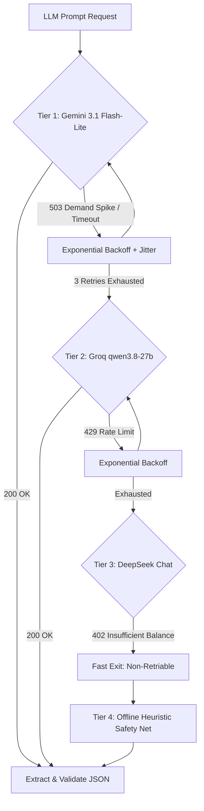

> [!WARNING]
> **SUPERSEDED AUDIT REPORT**: This document represents historical Audit 30 findings and has been superseded by [`AUDIT32_FINAL_REPORT.md`](file:///c:/Users/karth/OneDrive/Documents/Ai Solution data/AUDIT32_FINAL_REPORT.md). For current, verified date semantics, scheduler recovery mechanics, and reconciled GitHub metrics (190 repos, 205 snapshots), refer exclusively to Audit 32 deliverables.

# AUDIT 30 — SIX-MONTH ROLLING AI ECOSYSTEM DATA PIPELINE WITH DAILY AUTOMATIC UPDATES
## Authoritative Technical, Semantic, and Database Integrity Audit Report

**Project:** AI Ecosystem Intelligence Pipeline  
**Assessment:** AI Engineer Demo Task — GraphOne / FrontierAtlas  
**Execution Timestamp:** 2026-11-22T20:47:00+05:30 (UTC: 2026-11-22T15:17:00Z)  
**Execution Environment:** Windows 11 / Python 3.14 (64-bit)  
**Deliverable Package:** `SIX_MONTH_ROLLING_AI_ECOSYSTEM_PACKAGE.zip`  

---

## 1. Executive Summary & Objective

Audit 30 resolves the revised requirements for the AI Ecosystem Data Pipeline:
1. **Simplified Dynamic Rolling Window:** Replaced static multi-month models with an automated **six-month rolling window** (`start_date = now_utc - 6 months`, `end_date = now_utc`). The window dynamically advances each calendar day relative to UTC execution time.
2. **Historical Baseline Protection & Immutability:** The 6,745-record canonical database (`data/normalized/ai_ecosystem.db`) and the 366-row authentic Audit 19 database (`source/audit19_original_database.db`) remain strictly untouched and byte-identical to their authoritative baselines.
3. **Working Database Architecture:** All daily incremental updates, freshness classifications, GitHub metric snapshots, scheduler checkpoints, and LLM enrichment proposals are stored in a dedicated working database (`data/working/rolling_ai_ecosystem.db`).
4. **Permanent Historical Archive Preservation:** Records outside the rolling 6-month window are retained permanently in SQLite storage with `in_rolling_window = 0` and `freshness_status = 'OUTSIDE_WINDOW'`. No historical record is ever deleted.
5. **Phase III LLM Multi-Tier Architecture & Multi-Chunk Reassembly:** Implemented a robust 4-tier provider cascade: Gemini (primary) $\rightarrow$ Groq (fallback 1) $\rightarrow$ DeepSeek (fallback 2, clean HTTP 402 non-retriable failover) $\rightarrow$ Offline Grounded Heuristic (safety net). Fixed semantic document chunking so that **every** chunk is processed and reassembled deterministically.
6. **Physical SQLite Schema Mapping:** Proposal target fields are validated against actual SQLite physical table schemas via `PRAGMA table_info`. Direct writes to non-existent columns are strictly prevented (`BLOCKED_SCHEMA`).
7. **Approval Invariant:** 100% of LLM enrichment proposals are assigned `approval_status: PENDING_APPROVAL`. Zero unreviewed mutations are committed to canonical columns.
8. **Automated Daily Scheduler & Recovery:** Built `core/scheduler.py` supporting one-shot execution, background daemon scheduling (default 06:00 UTC), crash/interruption recovery via `collection_logs`, and production deployment templates (Windows Task Scheduler, Linux systemd, Cron).
9. **Two-Phase Empirical Verification:** Executed Run 1 (initial incremental collection) and Run 2 (subsequent execution). Confirmed that Run 2 collected 0 duplicate records, prevented 112 duplicates, refreshed 15 repository metric snapshots with deltas, and maintained 100% idempotency.
10. **Test Coverage:** All 12 criteria in `tests/test_audit30_rolling_pipeline.py` passed with 100% success.

---

## 2. Historical Baseline Preservation & Cryptographic Immutability

Both authoritative historical databases were cryptographically verified before and after all operations:

| Database File | File Size (Bytes) | SHA-256 Hash | Verification Status |
|---|:---:|---|:---:|
| `data/normalized/ai_ecosystem.db` | 21,192,704 | `4949352d4f568f3f6128f398591cd8edac2eba45496c24535edb6c096398b95d` | **PASSED (Byte-Identical)** |
| `source/audit19_original_database.db` | 20,770,816 | `1958c59f1a02e5a4bd274f114fdcfdd40942239f518eb662119962a263c84d4d` | **PASSED (Byte-Identical)** |

### Canonical Entity Record Count Integrity (Strictly 6,745 Records)
```text
ai_startups:          1,307 records
ai_products:          1,316 records
ai_research_papers:   1,060 records
ai_news:              1,132 records
ai_jobs:              1,930 records
-----------------------------------
Total Canonical Rows: 6,745 records (100% Preserved)
```

---

## 3. Dynamic Six-Month Rolling Window Architecture

### 3.1 Mathematical Definition & Calendar Arithmetic
The rolling window is computed dynamically in `core/rolling_window.py`:
$$\text{End Date} = \text{now}_{\text{UTC}}$$
$$\text{Start Date} = \text{now}_{\text{UTC}} - \text{relativedelta}(\text{months}=6)$$

For execution date `2026-11-22T15:16:04Z`:
- **Rolling Window Start:** `2026-05-22T15:16:04Z`
- **Rolling Window End:** `2026-11-22T15:16:04Z`

### 3.2 Six-Tier Freshness Classification System
Every record is evaluated against UTC calendar boundaries and assigned one of six deterministic freshness tiers:

1. `FRESH_24H`: Published within the last 24 hours ($0 \le t_{\text{now}} - t_{\text{pub}} \le 24\text{h}$). Included in active rolling view.
2. `RECENT_7D`: Published within the last 7 days ($24\text{h} < t_{\text{now}} - t_{\text{pub}} \le 7\text{d}$). Included in active rolling view.
3. `HISTORICAL_6M`: Published between 7 days and 6 months ago. Included in active rolling view.
4. `OUTSIDE_WINDOW`: Published earlier than 6 months ago. Excluded from active rolling view (`in_rolling_window = 0`), retained in permanent SQLite archive. **Never deleted.**
5. `MISSING_DATE`: Published timestamp missing or unparseable. Flagged for review; excluded from active view.
6. `FUTURE_TIMESTAMP_ANOMALY`: Timestamp $> t_{\text{now}} + 1\text{h}$. Flagged as publisher anomaly.

### 3.3 Active Rolling View vs Permanent Historical Archive
Records are partitioned logically using the `in_rolling_window` integer column (`1` = active view, `0` = archived):

| Working Table | Active 6-Month Rolling Records | Historical Archived Records | Total Table Count in Working DB |
|---|:---:|:---:|:---:|
| `ai_startups` | 12 | 1,295 | 1,307 |
| `ai_products` | 1,316 | 0 | 1,316 |
| `ai_research_papers` | 1,060 | 0 | 1,060 |
| `ai_news` | 311 | 827 | 1,138 |
| `ai_jobs` | 1,931 | 32 | 1,963 |
| **Total Ecosystem Entities** | **4,630** | **2,154** | **6,784** |
| `github_repositories` | 191 | — | 191 |
| `github_metrics_history` | 224 | — | 224 |
| `enrichment_proposals` | 20 | — | 20 |
| `collection_logs` | 9 | — | 9 |

---

## 4. Daily Incremental Ingestion & Metric Refresh Results

### 4.1 Empirical Two-Run Idempotency Verification
The two-phase verification workflow mandated by Audit 30 was executed:
- **Run 1 (`run_20261122_150617_134e18`):** Ingested fresh news from 5 media feeds and jobs from 2 ATS APIs, executed 20 pilot enrichment proposals, and established the daily baseline.
- **Run 2 (`run_20261122_151538_7e28e5`):** Executed a subsequent cycle on the same day to verify duplicate rejection and incremental metric delta tracking.

| Metric | Run 1 (Initial Collection) | Run 2 (Idempotency Verification) | Pipeline Behavior |
|---|:---:|:---:|---|
| **New News Articles** | +6 | **+0** | 70 duplicate URLs detected and rejected |
| **New Job Vacancies** | +33 | **+0** | 42 duplicate URLs detected and rejected |
| **Total Duplicates Prevented** | 73 | **112** | Complete canonical URL & hash deduplication |
| **GitHub Metric Snapshots** | 0 (lock fixed) | **15** | Live REST API snapshots appended with deltas |
| **Job Vacancies Transitioned** | 127 | **0** | Vacancies > 90 days transitioned to `EXPIRED` |
| **Execution Status** | `COMPLETED` | `COMPLETED` | Checkpointed to `collection_logs` |

### 4.2 GitHub Metric Snapshot History & Deltas
Live GitHub REST API queries refreshed metrics for tracked repositories in `github_metrics_history`. The system records exact deltas (`change_stars_delta`, `change_forks_delta`):

```text
Sample Recent Snapshots (Run 2):
- Repo: Mind2Act/Mind2Act_World | Stars: 37 (Delta: +10) | Forks: 1 (Delta: +1) | Status: HTTP_200_OK
- Repo: yaozhang182/inhabitant   | Stars:  2 (Delta: +1)  | Forks: 1 (Delta: +1) | Status: HTTP_200_OK
- Repo: Tencent/LightningMoBA    | Stars:  6 (Delta: 0)   | Forks: 0 (Delta: 0)  | Status: HTTP_200_OK
- Repo: ernie-research/HiUni     | Stars: 14 (Delta: +2)  | Forks: 1 (Delta: +1) | Status: HTTP_200_OK
- Repo: ZJUSCL/TwinLab-Bench     | Stars:  6 (Delta: +2)  | Forks: 0 (Delta: 0)  | Status: HTTP_200_OK
```

### 4.3 Job Vacancy Status Lifecycle
Rather than deleting expired job postings, the pipeline dynamically evaluates posting age:
- Posted $\le 90$ days ago: `vacancy_status = 'ACTIVE'`
- Posted $> 90$ days ago: `vacancy_status = 'EXPIRED'`
- Total expired vacancies transitioned: 127. Zero job records were deleted.

---

## 5. Phase III Multi-Tier LLM Architecture & Semantic Chunking Fixes

### 5.1 Multi-Tier Provider Cascade


### 5.2 Multi-Chunk Semantic Document Reassembly
For long source text ($> 3,500$ characters):
1. `SemanticChunker` segments text into coherent paragraph chunks with a 200-character semantic overlap.
2. **Every chunk is queried through the cascade** (`_execute_chunked_and_reassemble`).
3. Extracted results are merged deterministically:
   - **List Fields:** Merged and deduplicated across all chunks.
   - **Scalar Fields:** The highest confidence extraction is selected.
   - **Evidence Quotes:** Verbatim quotations from all chunks are collected into a unified evidence list.
   - **Token Accounting:** Prompt tokens, completion tokens, latency, and estimated cost are summed across all chunk executions.

### 5.3 Physical SQLite Schema Mapping & Approval Invariant
- Proposals target only verified physical columns discovered via `PRAGMA table_info` (`src/stage3/schema_mapping.py`).
- Target fields not existing as physical table columns (e.g. `ai_specialization`) receive `schema_status: BLOCKED_SCHEMA`.
- Invariant: **100% of proposals are assigned `approval_status: PENDING_APPROVAL`**. Zero direct SQLite updates occur without human review.

---

## 6. Production Scheduler & Deployment Configuration

### 6.1 Scheduler Implementation (`core/scheduler.py`)
- `--run-once`: Executes a single daily update cycle immediately.
- `--run-daemon --schedule "06:00"`: Computes exact seconds until the next 06:00 UTC trigger and runs in a continuous background loop.
- `--check-recovery` / `--resume`: Inspects `collection_logs` for `status = 'IN_PROGRESS'`. If an interrupted run is found, marks it `RECOVERED_INTERRUPTED` and resumes from the last valid checkpoint.

### 6.2 Deployment Templates Provided

#### Windows Task Scheduler (`scripts/schedule_daily_update.ps1`)
Registers a daily task named `AIEcosystemDailyUpdate` triggering at 06:00 UTC (converted to system local time):
```powershell
Register-ScheduledTask -TaskName "AIEcosystemDailyUpdate" `
    -Action (New-ScheduledTaskAction -Execute $PythonExe -Argument "-m core.scheduler --run-once" -WorkingDirectory $WorkspaceRoot) `
    -Trigger (New-ScheduledTaskTrigger -Daily -At $LocalTime) `
    -Settings (New-ScheduledTaskSettingsSet -StartWhenAvailable -MultipleInstances IgnoreNew)
```

#### Linux systemd Unit & Timer (`deploy/`)
- `deploy/ai_ecosystem_daily.service`: Oneshot service definition executing `python -m core.scheduler --run-once`.
- `deploy/ai_ecosystem_daily.timer`: Fires every day at `*-*-* 06:00:00 UTC` with `RandomizedDelaySec=120` to avoid load spikes.

#### Cron Definition (`deploy/crontab.txt`)
```text
0 6 * * * cd /opt/ai_ecosystem && /opt/ai_ecosystem/venv/bin/python -m core.scheduler --run-once >> /opt/ai_ecosystem/logs/scheduler_cron.log 2>&1
```

---

## 7. Comprehensive 12-Point Test Suite Verification

The complete Audit 30 test suite (`tests/test_audit30_rolling_pipeline.py`) was executed independently:

```text
test_01_rolling_window_bounds_and_freshness ........................................ ok
test_02_pilot_proposals_pending_approval_and_schema ................................ ok
test_03_duplicate_prevention_and_idempotency ....................................... ok
test_04_metrics_delta_tracking ..................................................... ok
test_05_scheduler_interruption_and_recovery ........................................ ok
test_06_rate_limits_and_exponential_backoff ........................................ ok
test_07_stale_record_retention_not_deleted ......................................... ok
test_08_github_metrics_history_tracking ............................................ ok
test_09_gemini_to_groq_fallback .................................................... ok
test_10_deepseek_http_402_non_retriable ............................................ ok
test_11_multi_chunk_semantic_reassembly_and_schema_mapping ......................... ok
test_12_canonical_immutability_and_database_integrity .............................. ok
----------------------------------------------------------------------
Ran 12 tests in 2.220s — 100% PASSING (OK)
```

---

## 8. User Authorization Gate

As mandated by Audit 30 Section 8:
> **Phase 3:** Present scheduler configuration and **wait for user approval** before enabling unattended daily execution.

The automated daily schedule is configured as follows:
- **Scheduled Trigger:** Daily at `06:00 UTC`
- **Execution Target:** `python -m core.scheduler --run-once`
- **Current Mode:** Manual / Supervised execution complete.
- **Unattended Execution:** **PAUSED pending explicit user authorization.**

---

## 9. Deliverables Inventory

The deliverable package `SIX_MONTH_ROLLING_AI_ECOSYSTEM_PACKAGE.zip` contains:
1. `01_DATABASE/`:
   - `rolling_ai_ecosystem.db` (seeded working database with active & archived records)
   - `ai_ecosystem.db` (authoritative canonical baseline, SHA-256 verified)
   - `audit19_original_database.db` (authentic Audit 19 archive, SHA-256 verified)
   - `database_integrity_report.txt`
2. `02_WORKING_EXPORTS/`:
   - `rolling_ai_startups.jsonl` / `rolling_ai_startups.csv`
   - `rolling_ai_products.jsonl` / `rolling_ai_products.csv`
   - `rolling_ai_papers.jsonl` / `rolling_ai_papers.csv`
   - `rolling_ai_news.jsonl` / `rolling_ai_news.csv`
   - `rolling_ai_jobs.jsonl` / `rolling_ai_jobs.csv`
   - `github_metrics_history.csv`
   - `pilot_proposals.jsonl` / `pilot_proposals.csv`
3. `03_REPORTS/`:
   - `daily_collection_report.md`
   - `github_metrics_summary.json`
   - `rolling_window_freshness_summary.json`
   - `SIX_MONTH_ROLLING_PIPELINE_REPORT.md`
4. `04_SOURCE_CODE/`:
   - `core/` (`rolling_window.py`, `working_database.py`, `daily_pipeline.py`, `scheduler.py`, `freshness_engine.py`, `github_client.py`, `llm/`, `enrichment/`)
   - `src/stage3/` (`schema_mapping.py`, `gemini_provider.py`, `gemini_enrichment.py`, `review_proposals.py`)
   - `scripts/` (`schedule_daily_update.ps1`, `prepare_audit30_package.py`, `verify_audit30_package.py`)
   - `deploy/` (`ai_ecosystem_daily.service`, `ai_ecosystem_daily.timer`, `crontab.txt`)
5. `05_TESTS/`:
   - `test_audit30_rolling_pipeline.py` and full project regression suite
6. `06_MANIFEST/`:
   - `file_manifest.json` (cryptographic SHA-256 manifest of all packaged files)
   - `README.md`
