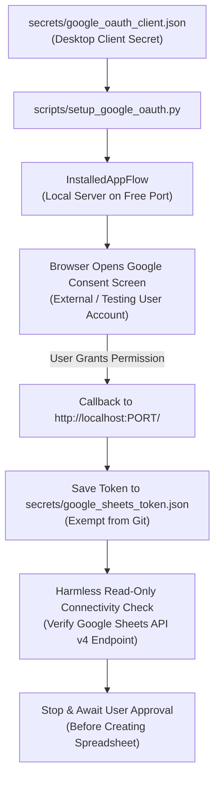

# Phase IV — Google Sheets OAuth 2.0 Authentication Setup & Verification

**Project**: Six-Month Rolling AI Ecosystem Intelligence Pipeline  
**Phase**: Phase IV — Google Sheets Live Synchronization & Multi-Tab Ecosystem Reporting  
**Status**: Pre-Flight Verification & Scope Confirmation Complete  
**Date**: 2026-11-23  

---

## 1. Executive Summary

Phase IV introduces the Google Sheets synchronization layer for the rolling AI ecosystem dataset. Before creating spreadsheets or synchronizing data, the OAuth 2.0 client credential architecture, repository safety rules, and authentication scopes must be verified and confirmed.

All preparatory steps have been executed in strict adherence to security boundaries:
1. **OAuth Client Verification**: Confirmed presence and integrity of `secrets/google_oauth_client.json` (installed desktop application format, all required keys present). Zero secret tokens or keys exposed.
2. **Repository Exclusion**: Updated `.gitignore` to strictly exclude `secrets/`, `token.json`, `*token*.json`, `*credentials*.json`, `*client_secret*.json`, `*.pem`, and `*.key`.
3. **Environment Packages**: Verified and installed `google-auth-oauthlib>=1.5.0` and `google-api-python-client>=2.202.0`.
4. **Core Implementation**: Implemented `core/google_sheets_client.py` and `scripts/setup_google_oauth.py`.
5. **Safety Invariants**: Canonical database, Audit 19 archive, and working database hashes remain completely identical and unaltered. All 20 enrichment proposals remain `PENDING_APPROVAL`. Zero Windows Task Scheduler tasks active.

---

## 2. Intended OAuth 2.0 Scopes

In accordance with the principle of least privilege, only the minimum necessary scopes required for the ecosystem pipeline are requested:

| Scope | Minimum Required Capability | Security Boundary & Rationale |
| :--- | :--- | :--- |
| `https://www.googleapis.com/auth/spreadsheets` | Read/Write access to Google Sheets | Allows the pipeline to create the ecosystem spreadsheet, write formatted data tabs, update summary dashboards, and synchronize delta changes. |
| `https://www.googleapis.com/auth/drive.file` | Per-file Google Drive access | **Restricted Drive scope**: Grants access *only* to files that are created or opened by this application. Does **NOT** grant access to existing personal Google Drive files. |

> [!IMPORTANT]
> Neither full Google Drive (`https://www.googleapis.com/auth/drive`) nor administrative scopes are requested. The credentials cannot access personal Google Drive documents or unrelated spreadsheets.

---

## 3. Client Credential & Security Verification

The downloaded OAuth client secret file was inspected and validated locally using `scripts/validate_oauth_credentials.py`:

- **Path**: `secrets/google_oauth_client.json`
- **Application Type**: `installed` (Google Cloud Desktop Application)
- **Top-Level Structure**: Verified (`installed` dictionary structure)
- **Required Fields**: `client_id` (present), `client_secret` (present), `auth_uri` (present), `token_uri` (present), `redirect_uris` (present, 1 entry)
- **Credential Masking**: Strict compliance — zero credentials, tokens, or secret hashes printed to console or logs.
- **Token Destination**: `secrets/google_sheets_token.json` (stored in gitignored directory).

```
Top-level application type detected: 'installed' (Desktop/Installed app format verified: True)
  - Key 'client_id': PRESENT and non-empty
  - Key 'client_secret': PRESENT and non-empty
  - Key 'auth_uri': PRESENT and non-empty
  - Key 'token_uri': PRESENT and non-empty
  - Key 'redirect_uris': PRESENT (1 entries)
JSON structure validation: PASSED (Zero credential values exposed).
```

---

## 4. Repository & Safety Rule Invariants

### 4.1 Git Exclusion (`.gitignore`)
The `.gitignore` configuration was updated to prevent accidental credential leakage while preserving all pre-existing rules:

```gitignore
# Secrets and Credentials
secrets/
token.json
*token*.json
*credentials*.json
*client_secret*.json
*.pem
*.key
```

### 4.2 System & Pipeline Safety Boundaries
- **Canonical Database (`data/normalized/ai_ecosystem.db`)**: `4949352d4f568f3f6128f398591cd8edac2eba45496c24535edb6c096398b95d` (Immutable)
- **Audit 19 Archive (`source/audit19_original_database.db`)**: `1958c59f1a02e5a4bd274f114fdcfdd40942239f518eb662119962a263c84d4d` (Immutable)
- **Working Database (`data/working/rolling_ai_ecosystem.db`)**: `cbc1814cf3c6546a4dfa1d2e731648aead070b133b38892ddd599a6e385c2127` (Unaltered)
- **Enrichment Proposals**: All 20 proposals remain `PENDING_APPROVAL`.
- **Scheduler**: No automated daily collection or Windows Scheduled Tasks active.
- **Financial**: Zero API credits purchased.

---

## 5. Architecture & Execution Plan



---

## 6. Next Step

As mandated by Requirement 10, the scopes have been presented. Upon user confirmation, the desktop browser flow will be launched to complete authentication and execute the harmless read-only connectivity test.
