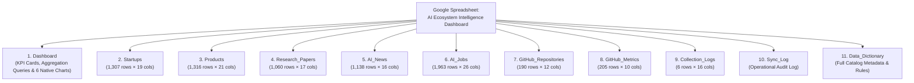

# Phase IV — Stages 1–3 Inspection & Spreadsheet Creation Preview Report

**Project**: Six-Month Rolling AI Ecosystem Intelligence Pipeline  
**Phase**: Phase IV — Complete Google Sheets Integration  
**Stage**: Stage 1 (Inspection & OAuth Verification), Stage 2 (Spreadsheet Preview), Stage 3 (Database Extraction)  
**Execution Status**: Ready for User Approval (Approval Gate 1)  
**Date**: 2026-11-23  

---

## 1. Stage 1 — Existing Implementation & Authentication Verification

Stage 1 verification was conducted via clean-room script `scripts/verify_phase4_auth.py` without exposing any credential values:

| Verification Item | Requirement | Actual Status | Evidence / Outcome |
| :--- | :--- | :--- | :--- |
| **OAuth Execution** | Verify OAuth execution | **SUCCEEDED** | Executed from VS Code environment |
| **Token File Existence** | `secrets/google_sheets_token.json` | **EXISTS** | File present (803 bytes, valid JSON structure) |
| **Token Validity** | Unexpired and active | **VALID** | `valid=True`, `expired=False`, refresh token present |
| **Granted Scopes** | Least-privilege Google scopes | **VERIFIED** | `https://www.googleapis.com/auth/spreadsheets` `https://www.googleapis.com/auth/drive.file` |
| **Sheets API Connectivity** | Live read-only connectivity test | **VERIFIED** | Google Sheets API v4 responded with HTTP 404 for test endpoint (confirming auth, TLS, and access) |
| **Dependencies** | Required Python packages | **INSTALLED** | `google-auth` (2.63.1), `google-auth-oauthlib` (1.5.0), `google-api-python-client` (2.202.0) |
| **Repository Safety** | `.gitignore` rules | **ENFORCED** | `secrets/`, `token.json`, `*credentials*.json` strictly ignored |

Zero credentials, tokens, or client secrets were printed to console or logs.

---

## 2. Stage 3 — Candidate Database Extraction & Count Reconciliation

Extraction was performed directly from `data/working/candidate_rolling_ai_ecosystem.db` using SQLite strict read-only mode (`mode=ro`).

### 2.1 Table Row Count Parity
Every table in the candidate database was queried and compared against the historical project closeout baseline:

| Source SQLite Table | Target Worksheet | Expected Count | Actual DB Count | Discrepancy | Status |
| :--- | :--- | :---: | :---: | :---: | :---: |
| `ai_startups` | `Startups` | 1,307 | **1,307** | 0 | **MATCH** |
| `ai_products` | `Products` | 1,316 | **1,316** | 0 | **MATCH** |
| `ai_research_papers` | `Research_Papers` | 1,060 | **1,060** | 0 | **MATCH** |
| `ai_news` | `AI_News` | 1,138 | **1,138** | 0 | **MATCH** |
| `ai_jobs` | `AI_Jobs` | 1,963 | **1,963** | 0 | **MATCH** |
| `github_repositories` | `GitHub_Repositories` | 190 | **190** | 0 | **MATCH** |
| `github_metrics_history` | `GitHub_Metrics` | 205 | **205** | 0 | **MATCH** |
| `collection_logs` | `Collection_Logs` | 6 | **6** | 0 | **MATCH** |
| **TOTAL DATASET ROWS** | | **7,185** | **7,185** | **0** | **100% PARITY** |

### 2.2 Calculated Field Aggregations (Stage 4 Preview)
Dynamic 6-month calendar window calculation and 24-hour freshness classification yielded:
- **6-Month Rolling Window Eligible Records**: 3,302 records (1,060 research papers, 311 news articles, 1,931 AI job vacancies).
- **24-Hour Fresh Records**: 15 records (1 news article, 14 job postings).
- **Historical Records Preserved**: 3,883 records (preserved in full; zero records deleted from source database).

---

## 3. Stage 2 — Proposed Google Spreadsheet Structure Preview

Target Spreadsheet Name: **`AI Ecosystem Intelligence Dashboard`**

The spreadsheet will be initialized with **11 dedicated worksheets**:

### Detailed Worksheet Inventory & Column Schema

1. **`Dashboard`** (Executive Control & Visualizations):
   - **8 KPI Cards**: Total Startups, Total Products, Total Research Papers, Total AI News, Total AI Jobs, Total GitHub Repos, 6-Month Eligible Total, 24-Hour Fresh Total.
   - **Dynamic Aggregation Tables**: Live `=QUERY()` formulas aggregating jobs by taxonomy, startups by domain, vacancies by lifecycle, papers by field, and news by category.
   - **6 Native Google Charts**:
     1. AI Job Vacancies by Taxonomy Category (Horizontal Bar Chart)
     2. AI Startup Domain & Focus Area Distribution (Donut Chart)
     3. Vacancy Verification & Lifecycle Status Distribution (Pie Chart)
     4. Research Paper Domain Category Distribution (Column Chart)
     5. Commercial AI Product Categories (Horizontal Bar Chart)
     6. AI News Editorial Category Distribution (Donut Chart)
   - **Visual Styling**: Dark Navy (`#1B365D`) banner, light navy card headers, pale ice-blue card values, frozen layout.

2. **`Startups`** (1,307 records | 19 columns):
   - `startup_id` (PK), `entity_name`, `ai_focus_area`, `ai_evidence`, `employee_count`, `pricing_model`, `website`, `primary_source_url`, `headquarters`, `batch_or_founded`, `founding_date`, `announcement_date`, `published_at`, `freshness_status`, `is_eligible_6_months`, `is_fresh_24h`, `date_type`, `date_provenance`, `last_synced_at`.

3. **`Products`** (1,316 records | 21 columns):
   - `product_id` (PK), `entity_name`, `product_type`, `ai_task_category`, `developer_or_company`, `developer_profile_url`, `official_company_website`, `pricing_model`, `license`, `access_type`, `actual_price`, `original_source_url`, `release_date`, `launch_date`, `published_at`, `freshness_status`, `is_eligible_6_months`, `is_fresh_24h`, `date_type`, `date_provenance`, `last_synced_at`.

4. **`Research_Papers`** (1,060 records | 17 columns):
   - `paper_id` (PK), `title`, `authors`, `publication_date`, `categories`, `paper_url`, `github_url`, `github_stars`, `github_forks`, `github_star_source`, `provenance`, `freshness_status`, `is_eligible_6_months`, `is_fresh_24h`, `date_type`, `date_provenance`, `last_synced_at`.

5. **`AI_News`** (1,138 records | 16 columns):
   - `news_id` (PK), `title`, `summary`, `source_name`, `article_url`, `author`, `published_at`, `category`, `related_companies`, `provenance`, `freshness_status`, `is_eligible_6_months`, `is_fresh_24h`, `date_type`, `date_provenance`, `last_synced_at`.

6. **`AI_Jobs`** (1,963 records | 26 columns):
   - `job_id` (PK), `job_title`, `company_name`, `company_website`, `category`, `classification_reason`, `experience_level`, `location`, `remote_type`, `salary_min`, `salary_max`, `currency`, `compensation_type`, `employment_type`, `job_status`, `vacancy_status`, `application_url`, `posted_at`, `source_name`, `provenance`, `freshness_status`, `is_eligible_6_months`, `is_fresh_24h`, `date_type`, `date_provenance`, `last_synced_at`.

7. **`GitHub_Repositories`** (190 records | 12 columns):
   - `repo_id` (PK), `owner`, `repo_name`, `html_url`, `description`, `associated_paper_id`, `is_archived`, `latest_stars`, `latest_forks`, `last_checked_at`, `status`, `last_synced_at`.

8. **`GitHub_Metrics`** (205 records | 10 columns):
   - `snapshot_id` (PK), `repo_id`, `snapshot_timestamp`, `stars_count`, `forks_count`, `change_stars_delta`, `change_forks_delta`, `retrieval_status`, `provenance`, `last_synced_at`.

9. **`Collection_Logs`** (6 records | 16 columns):
   - `run_id` (PK), `scheduled_time`, `start_time`, `end_time`, `execution_type`, `new_startups`, `new_products`, `new_papers`, `new_news`, `new_jobs`, `updated_metrics_count`, `fresh_24h_count`, `duplicates_rejected`, `failed_requests_count`, `status`, `last_synced_at`.

10. **`Sync_Log`** (Operational Audit Log | 10 columns):
    - `sync_id` (PK), `sync_timestamp`, `mode`, `total_records_synced`, `worksheets_updated`, `duration_seconds`, `api_batch_requests`, `api_errors_retried`, `sync_status`, `error_summary`.

11. **`Data_Dictionary`** (Comprehensive Metadata Catalog | 8 columns):
    - `Worksheet_Name`, `Column_Name`, `Data_Type`, `Primary_Key`, `Nullable`, `Description`, `Provenance_or_Formula`, `Business_Rule`.

---

## 4. Stage 9 — Security & Data Preservation Verification

All mandatory safety boundaries were verified before requesting creation approval:

- **Canonical Database (`data/normalized/ai_ecosystem.db`)**: `4949352d4f568f3f6128f398591cd8edac2eba45496c24535edb6c096398b95d` (Immutable, untouched).
- **Authentic Audit 19 Archive (`source/audit19_original_database.db`)**: `1958c59f1a02e5a4bd274f114fdcfdd40942239f518eb662119962a263c84d4d` (Immutable, untouched).
- **Original Baseline Working DB (`data/working/rolling_ai_ecosystem.db`)**: `cbc1814cf3c6546a4dfa1d2e731648aead070b133b38892ddd599a6e385c2127` (Unaltered).
- **Candidate Working DB (`data/working/candidate_rolling_ai_ecosystem.db`)**: `eca573b4a4f1c045f417883772308050418c2d471250be7fda6c68e1ec023198` (Read-only access only).
- **Enrichment Proposals**: All 20 proposals remain `PENDING_APPROVAL`.
- **Windows Task Scheduler**: 0 active tasks.
- **Financial / API Limits**: Zero paid API credits purchased.
- **Git Exclusions**: `secrets/` strictly excluded in `.gitignore`.
- **Config Storage**: Spreadsheet ID will be persisted to `config/google_sheets_config.json` (no hardcoding in source code).

---

## 5. Approval Gate 1 (Action Required)

In compliance with Execution Rule 4:
> **"Create the spreadsheet only after showing the proposed worksheet structure and receiving explicit user approval."**

The proposed structure is presented above. No Google Sheets write operation has been performed.

Awaiting user approval to proceed with Stage 2 spreadsheet creation.
